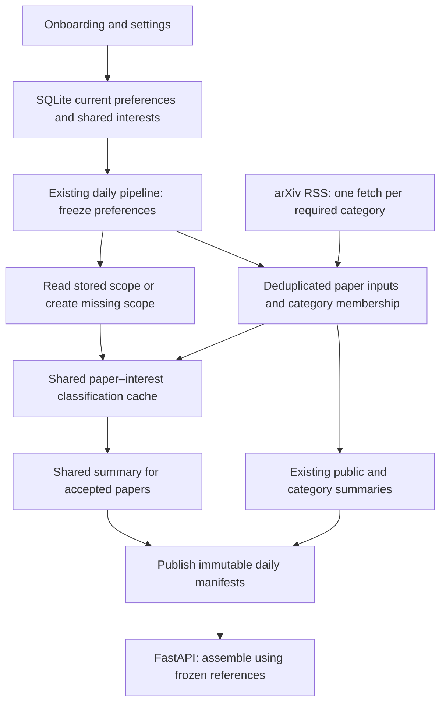

# Semantic interest feeds — technical design

Status: proposed architecture; documentation only, no implementation authorization.
Date: 2026-10-06.
Product contract: [Semantic interest feed specification](SEMANTIC_INTEREST_FEED_SPEC.md).

Implementation update, 2026-10-13: milestone 0 accounting is implemented locally
and verified offline under subsequent owner authorization; production activation
remains pending. Follow the [implementation plan](SEMANTIC_INTEREST_FEED_IMPLEMENTATION_PLAN.md)
for current sequencing: shared accounting precedes paid evaluation. Semantic
matching, migrations and archive changes below remain proposed work.

Review disposition: owner approved review recommendations 2–7 (delivery-aware
scheduling, explicit generation completeness, public-path isolation, frozen run
versions, less unnecessary work/cleanup, and whole-feed evaluation). These are
incorporated below. The owner supplied account quotas below; the publishing window
remains to be set and the approved daily Gemini budget is USD $15. The earlier
18-call limit was a design assumption,
not a Gemini quota.

## Decision

Extend the existing daily Python pipeline, FastAPI/Jinja app, SQLite database,
and content directory. Use the existing Gemini client for focused scope creation
and batched semantic classification. Store scopes once, cache both positive and
negative paper–interest decisions, and publish immutable daily preference
snapshots referencing shared results. Do not add a queue service, vector
database, embeddings, background web worker, or separate personalization API.

This is the simplest proposed approach, subject to a measured relevance and
capacity gate before launch. The system shares computation independently of
reader count; distinct interests still cost work. Embedding retrieval becomes
an option only if exhaustive batched classification exceeds the operating
budget and demonstrates a quality-preserving alternative in evaluation.

## Existing system and required changes

| Existing component | Retain | Necessary change |
| --- | --- | --- |
| `api/main.py` | Daily entry point, public blog generation | Fetch category union once; orchestrate snapshots, semantic processing, publication |
| `api/arxiv_client.py` | RSS parsing, latest publication-date filtering, retries and pacing | Return explicit source status/date and grouped membership; distinguish failure from an empty feed |
| `api/agent.py` | Installed `google-genai` client, current Gemini model | Add separate structured scope, relevance, and summary calls; leave thematic prompts for public/category content |
| `api/feeds.py` | Category Markdown format and New York feed date | Reuse fetched papers; checkpoint category artifacts and publish daily manifests |
| `app/schema.sql`, `app/db.py` | SQLite WAL, existing account/category tables | Add interests, caches and manifests with additive migrations |
| `app/routes.py` | Existing routes, authentication, CSRF, shared form save path | Atomic preference save; suggestions; manifest-based archives and daily rendering |
| Jinja templates and category picker | Existing layout and picker behavior | Three-category limit, optional input with five-phrase limit, suggestion buttons, interest sections and processing states |
| Docker Compose and systemd | Same services, mounts and 6am Eastern timer | API writes shared SQLite; mount a pipeline lock; set service timeout from the agreed processing window |

The fixed public categories in `api/settings.py` include `stat.ML` in addition
to the four CS categories. Use the actual settings, not the shorter AGENTS list.
The current public and category paths independently fetch overlapping RSS feeds.
The current archive reads current preferences and cannot preserve historical
selections. The current fetch helper returns `[]` for both failure and emptiness.
These are the three existing behaviors that must change.

The API image currently includes only `api/`, while the app image includes
`app/`. Keep pipeline persistence helpers in `api/`; do not make the daily image
import FastAPI app configuration or require OAuth secrets. The app owns schema
migrations. The pipeline checks the required schema version before its new work.
An unavailable or incompatible personalized database disables personalized work
for that invocation, while the existing fixed-category public path can continue.

## Architecture and responsibility boundaries

FastAPI saves preferences and reads published content. It never calls Gemini or
fetches RSS. The daily process is the only semantic worker and the only publisher.
SQLite holds structured semantic output and account-owned manifests. The content
directory continues to hold shared category Markdown. Public Jekyll publishing
retains its current output format and thematic behavior.

## Preferences, identity and activation

- Allow one to three active categories and zero to five interests. These owner
  limits supersede the earlier five-category/ten-interest design. Each phrase has
  a maximum of 100 Unicode characters after whitespace cleanup. Reject control
  characters. Apply a bounded request-body limit before parsing the form.
- Preserve already-saved category selections during migration, including those
  exceeding the new limit. Their next preference save requires reduction to three;
  display existing selections and an explanatory message rather than automatically
  dropping categories. Historical snapshots retain their original selections.
- Split only on semicolons; trim, collapse Unicode whitespace, and use Unicode
  `casefold()` for identity. Preserve punctuation, accents, commas and hyphens.
  Do not merge synonyms, spelling variants or acronyms. Store a normalization
  version so a future normalization change requires an explicit migration.
- The shared interest label is the first cleaned spelling saved. Each reader
  separately stores their display spelling and position. Normalized identity
  has a unique database constraint, preventing duplicate concurrent submissions.
- Save categories, interests and a preference revision increment in one explicit
  transaction. Existing `app/db.py` uses autocommit: consecutive DELETE/INSERT
  calls are not currently an atomic preference replacement. Fix this shared
  save path as part of the feature.
- At the first run for a New York date, read preferences in one short SQLite
  transaction and insert immutable draft manifests. This is the day's cutoff.
  Saves after that cutoff apply to the next date's run, even if today's job is
  still running. Retries read the same drafts, never current preferences.
- Pin the run's New York date, source batches, matching/summary model IDs,
  prompt/schema/generation versions, and each required scope-version ID. For a
  new scope, reserve its version and defining prompt/model before calling Gemini.
  Persist enough configuration to reproduce the planned call, not only a hash.
  Resumption uses this frozen contract. If a new deployment cannot execute it,
  report unavailable work rather than silently switch versions mid-run.
- New accounts created after the cutoff get their first manifest next cycle.
  Preference changes do not create historical sections or fetch past batches.
- Show “Applies to the next daily feed, usually after 6am Eastern.” Timer jitter,
  processing time and failures mean 6am is not a delivery guarantee.

## Scope creation once

The daily worker creates a required interest's missing scope before matching
that interest. It does not create every pending scope before serving ready ones.
One structured Gemini call creates a scope with: intended concept, a short list
of close included methods, explicit exclusions, and an ambiguity note. Scope
text is concise (target at most 400 words), technical and independent of reader,
category and date. No web research or recursive expansion occurs.

For `speculative decoding`, include draft-and-verify generation, acceptance
methods and closely connected decoding variants; exclude unrelated inference
speed improvements without a substantive decoding connection. For ambiguous
phrases, use a conservative conventional research meaning and record ambiguity;
do not silently generate a broad union of every possible meaning. The settings
page can show a brief interpretation once available. Readers refine a phrase
through normal preference edits if the interpretation is wrong.

Scope status is pending, ready or failed. Validate required fields and bounds
before marking ready. Reuse a ready scope forever unless an operator explicitly
creates a new immutable version for future days. A model/prompt deployment does
not automatically regenerate every existing scope. Daily matching retrieves
the stored scope and is instructed not to expand it.

“Once” means one successfully stored definition per version. A failed or
interrupted provider call can require a retry, including an unavoidable repeated
call if the process dies after the provider responds but before persistence.
Do not promise exactly-once external billing. Successful saved scopes are never
called again during ordinary processing.

## Semantic matching and summaries

Use all fetched titles and abstracts in the selected category boundary. Do not
filter using thematic summaries, exact phrase occurrence, or the public blog's
selection of important papers; those would discard relevant candidates.

For each interest, derive the union of categories selected by readers following
that interest. Deduplicate papers within that union. Look up the immutable
paper-input/scope/matching-version cache before making calls. Batch remaining
papers for one scope per call, initially at most 25 papers and approximately
24,000 input characters, whichever limit comes first. Reduce batches when output
limits demand it. A single oversized abstract gets its own bounded call; never
silently truncate it and mark an incomplete analysis complete.

Return one decision per supplied internal paper-input ID:

- `direct`, `close`, or `unrelated` relevance;
- a one-sentence explanation for accepted matches;
- a short supporting excerpt from the supplied abstract for accepted matches.

Accept `direct` and `close`; `close` requires a concrete connection covered by
the stored scope. Reject broad adjacency and uncertain cases. Rank direct first,
then close, with normalized title and paper ID as deterministic tie-breakers.
This avoids a spurious precision score and an arbitrary top-N quota. It is a
categorical relevance ranking, not a calibrated probability ranking.

Use structured JSON responses and validate them locally: enum values, exact
expected IDs, no omissions or duplicates, text bounds and supporting excerpt
presence. An exact supporting excerpt is useful evidence but does not prove the
interpretation is correct; reviewed evaluation remains necessary. Unknown IDs,
missing decisions or invalid explanations fail the batch; never count omitted
papers as negatives. Paper abstracts and interest text are untrusted data, not
instructions; no tools, arbitrary URLs or generated executable content are used.

Gemini supports schema-constrained output, but schema conformance does not
establish semantic correctness. Verify support with the installed SDK and
configured model during implementation; use ordinary JSON parsing and local
validation without adding a schema dependency solely for this feature.
[Gemini structured output documentation](https://ai.google.dev/gemini-api/docs/structured-output).

Cache accepted and rejected decisions. Each accepted paper gets one short,
plain-language summary from its abstract, generated separately in batches only
when no shared summary exists. This prevents different interests from producing
different generic summaries. Interest explanations remain separate cached text.
If summary generation fails, preserve the match cache, mark the paper unavailable
for publication, and retry before the day's publication deadline.

### Reuse example

Reader A follows speculative decoding in `cs.LG` and `stat.ML`; reader B follows
it in `cs.LG` and `cs.AI`. Fetch each category once. Classify each unique paper
in their combined category union once for that scope. Cross-listed papers share
the same decision and summary. At assembly, restrict A to A's memberships and B
to B's memberships. No category context is passed to classification, so its
decision remains reusable across categories. Category membership controls
eligibility, not interpretation.

This implements the product's interest/category reuse requirement at the finer
paper–interest level. Adding a reader or an already-processed overlapping
category creates no extra classification. Distinct normalized phrases can
overlap semantically but remain distinct work; automatic synonym merging is
outside scope.

## Persistence model

Use additive tables in the existing SQLite database. JSON columns below are
application-validated serialized documents; do not require SQLite JSON functions.
The following defines logical fields and constraints, not migration SQL.

| Table | Contents and constraints |
| --- | --- |
| `interests` | ID, unique normalized phrase plus normalization version, shared label, first-created timestamp, current scope version ID (nullable) |
| `user_interests` | User ID, interest ID, personal label, position; unique user/interest and user/position; user foreign key cascades on deletion |
| `interest_scopes` | Interest ID, version, scope JSON, status, model and prompt version, attempts/error/timestamps; unique interest/version; ready content immutable |
| `paper_inputs` | ID, canonical arXiv identity, input hash, exact title/abstract/authors/URL; unique identity/input hash; immutable input revision |
| `category_batches` | Day, category, status, source publication date, sorted paper-input IDs, membership fingerprint and error; unique day/category; frozen once published |
| `paper_interest_results` | ID, paper-input ID, scope-version ID, matching-version hash, relevance, explanation/evidence; unique input/scope/matching-version; immutable valid result |
| `paper_summaries` | ID, paper-input ID, summary-version hash, plain text; unique input/summary-version; immutable |
| `user_daily_feeds` | User ID, day, preference revision, frozen categories/labels/interests/order, draft or published state, final manifest JSON and publication timestamp; unique user/day; user deletion cascades |

Add `preferences_revision` and a nullable `legacy_feed_categories_json` to
`users`. Extend existing `daily_runs` with a unique canonical run per date after
checking any existing rows, cutoff/deadline, pipeline version, attempts and final
state, the frozen processing contract, budget counters and the next-interest
processing cursor. Do not introduce
a second run registry or a generic task framework.
No existing pipeline currently writes `daily_runs`; inspect production rows
before applying its uniqueness migration.

Index current interest selections by interest/user, manifests by user/day and
publication state, category batches by category/source date, and cache keys by
their unique compound identities. Keep timestamps in UTC; only the feed-day key
uses America/New_York. Validate reference integrity when publishing manifests;
JSON reference arrays do not receive automatic foreign-key enforcement.

Each category batch records success with papers, success empty, or failure.
An already-consumed source publication date is `no_new_batch`; do not relabel
yesterday's unchanged RSS payload as new papers each weekend. Preserve the
existing latest-pubDate selection, but retain its date. If source dates are
missing or inconsistent enough to prevent safe freshness decisions, report
unavailable instead of silently asserting a new empty batch. A future revised
paper input is eligible only when it appears in a future source batch.

Extract modern and legacy arXiv IDs from trusted source URLs, normalize scheme
and version suffix for identity, and retain exact input revisions through the
hash. Use a normalized trusted URL fallback if identity parsing fails. Hash all
classification-relevant fields and record the hashing format version. Do not
merge papers by title. Membership comes from the feeds actually fetched; do not
infer unobserved category membership from an LLM.

Matching-version and summary-version hashes cover model ID, prompt, output schema
and generation settings. Scope version is a separate explicit identity. Changing
versions affects future computations, never stored archived references.

The final daily manifest records mode, ordered section labels, category batch
references and final section status. For semantic sections it contains the
ordered accepted result and summary IDs after category filtering/deduplication.
For category mode it records shared Markdown path and content hash or empty/error
status. This small materialized reference list makes archived rendering immune
to later cache insertions, current scope changes or current preferences.
Readers share the referenced text; manifests duplicate only IDs and small
preference metadata. A manifest with no matches is still a valid archive entry.

## Daily execution, failure and publication

1. Acquire a nonblocking OS file lock under the shared DB mount before any
   pipeline work, including public generation. Use Python's `fcntl` on the
   deployed Linux host. A second invocation exits without duplicating calls;
   the kernel releases the lock after a crash. Single host is the explicit ceiling.
2. Create or resume the day's `daily_runs` record and draft preference snapshots.
   Snapshot preferences and the processing contract atomically, then release the
   DB transaction. If personalized SQLite is unavailable, log that failure and
   continue the public-only path; do not invent personalized snapshots.
3. Fetch fixed public categories first and publish their deduplicated public
   summary. Then fetch remaining categories required by snapshotted readers.
   Fetch each category once logically, with bounded network retries. Reuse the
   public inputs for personalized work and persist successful batches before
   generation. Pass the remaining deadline into RSS timeouts, retries and sleeps;
   mark unfinished sources unavailable while time remains to finalize feeds.
4. Generate category Markdown only for categories selected by snapshotted
   category-only readers. Semantic-only categories do not need thematic blurbs.
   Both public and category generation return text plus explicit completed/failed
   batch information. Checkpoint successful intermediate batches for retries;
   nonempty output alone does not mean processing is complete. Carry partial
   generation status through to each affected category-mode manifest.
5. Schedule work across interests in a persisted round-robin order, creating a
   missing scope only as that interest receives service. Limit new-scope attempts
   so ready interests receive service too. After a matching batch, complete its
   missing shared summaries before dispatching further classification that could
   consume the publication reserve. Batch summaries where possible. Reserve time,
   calls and token capacity for finishing accepted papers and final publication;
   the reserve is calibrated from measurements. Failed scopes get at most one
   attempt before other eligible interests receive service; additional retries
   use only remaining capacity within the per-run retry bound.
6. Assemble final manifests from frozen preferences and available outputs. Mark
   partial sections when any required source or matching work is unavailable.
   “No matches” requires all relevant sources and decisions to be complete.
7. Publish manifests in short transactions, rechecking that each user still
   exists. Publishing a reader's manifest is atomic. Finish the run status and
   metrics; never rewrite a published manifest.

Checkpoint public and category artifacts with the frozen run date, content hash,
generation status and input/version fingerprint. Write to a temporary file and
atomically replace only when first publishing; never regenerate a published
artifact during a semantic retry. The public checkpoint must work without app
SQLite: store its small record beside the generated post. The post remains the
commit marker; embed enough generation metadata to recover if a crash occurs
between post publication and checkpoint persistence. The existing public writer
must receive the frozen date rather than calculating a new date during retries.

The scheduler's success measure is publishable papers, not completed model calls.
Verify fairness over consecutive overloaded days, including repeated scope
failures and summary failures. Work not delivered before a day's closure will
not be recovered through backfill.

While draft, `/feed` may show a separate “Today's feed is processing” notice.
Drafts are not archive entries. Published complete, empty, partial and unavailable
days all appear in the archive. Existing public publication should run before
semantic work; a semantic failure cannot suppress a successful public post.

Transient failures receive bounded retries while the run is still open; cached
successes survive retries. On deadline, publish what is available with honest
partial/unavailable states and close the day. Once published, an incomplete
section is not filled later: doing so would change the day's feed. Subsequent
days retry scopes and process their own new papers, without backfilling missed
daily batches. This is the direct consequence of the approved history rule.

If a hard crash prevents publication, the next invocation first closes older
unfinished drafts from already persisted outputs, marking incomplete work
unavailable. It performs no new historical retrieval or model calls. An explicit
same-day rerun before the deadline may resume unfinished work; a later rerun only
finalizes. Catastrophic storage failure can still prevent publication and must
produce an operational alert rather than a fabricated successful feed.

| Event | Run and manifest transition | Permitted work |
| --- | --- | --- |
| First invocation for the day | Create open run and draft manifests; freeze inputs and versions | Retrieve and process within the agreed window |
| Retry while the run is open | Resume the same run and drafts | Reuse successes; process only missing work under frozen versions |
| A reader's required work completes | Atomically publish that reader's complete or empty manifest | Continue work for other drafts; never change this published manifest |
| Deadline or exhausted daily capacity | Publish remaining drafts as partial or unavailable; close run | Persist final state and metrics |
| Crash and restart before deadline | Resume persisted open run | Same missing-work rules, without resetting budgets |
| Restart after deadline or on a later day | Finalize old drafts from already persisted outputs; close old run | No old-day retrieval, model calls or backfill |
| Invocation for a closed run | Leave published artifacts unchanged | Read/report existing state only |

“Pending” and “processing” describe drafts only. Published incomplete sections
say “Unavailable for this day” or identify partial coverage; they do not promise
that more results will arrive. Generation completeness is distinct from source
retrieval completeness and must be recorded separately.

SQLite WAL permits readers alongside a writer but still has a single writer.
Use foreign keys, the existing busy timeout, short explicit transactions and no
network calls inside transactions. Copy cutoff preferences into persisted drafts
and close the read transaction instead of retaining a snapshot throughout the
run. [SQLite WAL documentation](https://www.sqlite.org/wal.html).

## Budgets and operating limits

The earlier 18-call/10-minute semantic limit and 25-minute soft deadline are
withdrawn as launch defaults. They were not provider limits. Actual quota values,
affordable daily usage and the acceptable publishing window must determine
capacity. The currently deployed service still has `TimeoutStartSec=30min`;
extending processing requires changing that setting during implementation.

Proposed scheduling choice: retain one daily systemd trigger and one resumable
worker using sequential calls without an unconditional 30-second sleep. Allow
a longer run if measured work requires it; set the systemd timeout above its
publication deadline with shutdown headroom. Choose that deadline from measured
work and the acceptable delivery time. Finish each reader's
feed as its required work completes; publish remaining partial/unavailable drafts
at the deadline. Longer preparation before first publication does not change
published days and does not constitute backfill.

Multiple timer invocations are an alternative for crash recovery or operational
convenience, but must resume the same open daily run, take the same lock and use
the same persisted budget. They do not create extra provider quota. A long-running
worker is initially simpler than several independent cron jobs.

The owner supplied these `Gemini 3.1 Flash Lite` values from
[Google AI Studio rate limits](https://aistudio.google.com/rate-limit) on
2026-10-06. Interpret the right-hand values as limits; the left-hand values are
the usage displayed by the console, not additional quota.

| Metric | Displayed usage | Limit |
| --- | --- | --- |
| RPM | 7 | 4,000 requests per minute |
| TPM | 428.04K | 4,000,000 input tokens per minute |
| RPD | 37 | 150,000 requests per day |

Confirm during rollout that the deployed API key belongs to this project. The
billing tier was not supplied and should not be inferred from these values.
These quotas do not justify an 18-call daily cap or a fixed 30-second delay.
For illustration, 200 calls consume about 0.13% of the stated daily request
allowance; actual token usage, request duration and cost must still be measured.
Recheck the console before launch because project limits can change. Gemini applies
limits per project, not per API key, and RPD resets at midnight Pacific time.
Pacing can accommodate minute limits; spreading calls across a day cannot exceed
that day's request quota. [Official quota documentation, checked 2026-10-06](https://ai.google.dev/gemini-api/docs/rate-limits).

Use one call boundary for public, category and semantic work. Pace against both
request and token allowances, leave headroom for other project usage, and respect
provider retry guidance on transient rate-limit errors. Record actual usage and
use bounded backoff and request timeouts. Stop dispatching work that cannot fit
before the publication reserve. Do not keep retrying an exhausted daily quota
as if it were a short minute-limit delay.

At most three attempts for a scope version or failed batch remain a per-run
retry bound, subject to fair scheduling and available quota. Persist request
reservations and usage counters so restarts cannot reset budgets. Reserve output
capacity and a measured cost allowance before dispatching requests. Set a currency
reservation from verified pricing; do not infer cost from call count alone.

**Approved daily cost ceiling: USD $15.** Apply it to all PaperPulse Gemini calls:
public and category summaries, new scopes, relevance decisions, shared summaries
and retries. Budget days are calendar days in America/New_York, matching feed
dates; the provider's midnight-Pacific quota reset does not reset this budget.
All same-day invocations share one allowance. Hosting, taxes and calls from other
applications are outside this PaperPulse model-usage budget.

Before each request, reserve a conservative maximum charge from its input token
count (or a safe upper bound), configured maximum billable output including any
thinking tokens, and verified model prices. Dispatch only if recorded spend plus
unresolved reservations plus this request's reservation fits within $15 and leaves
the required summary reserve. After a successful response, reconcile against
reported billable usage and release the unused reservation. Unknown usage after
a timeout/crash retains its reservation; a retry needs a separate reservation.
This prevents an in-flight request or restarted process from knowingly exceeding
the allowance. Use conservative standard prices rather than assume discounts.

Keep the authoritative daily spend/reservation ledger as a small atomically
replaced file under the shared persistent volume, protected by the pipeline lock.
This allows the public-only fallback to enforce the same ceiling when app SQLite
is unavailable. Mirror totals in run metrics; do not create an independent budget
for the fallback. If the ledger cannot be safely read or written, stop paid calls
and report unavailable work rather than proceed without enforcement.

When no additional request fits, stop Gemini dispatch, persist successful outputs,
and finalize remaining drafts as partial/unavailable. Finish and publish cached
complete results without further model charges. Do not automatically increase
the approved ceiling or resume paid work for a published day. Verify reservation,
reconciliation, restart, retry and public-fallback behavior during implementation.

Start with one in-flight request, proceeding immediately after each response
unless quota accounting or provider feedback requires waiting. Apply a shared
request/token guard using the supplied limits and headroom; no parallel workers
are needed merely to accommodate hundreds of calls daily. Model latency may
still require a longer publishing window. The processing window remains open;
account for public/category generation, scopes, matching, summaries
and retries together. Evaluate completed feeds under sustained load before
accepting the capacity plan.

With C fetched categories, P unique paper inputs and I distinct scopes, retrieval
scales with C; semantic decisions scale with the sum of each interest's eligible
unique papers (worst case P × I), not users × categories × interests. Approximate
calls are missing scope calls plus matching batches plus missing summary batches.
Track all three separately; reader growth with identical selections should add
manifest writes but no Gemini calls.

Initial audience: 10–20 readers in up to three categories each. The owner's
latest expected-use scenario is 20 readers following three phrases each:
60 phrase assignments and at most 60 distinct normalized interests when none
are shared. The selection limit remains five phrases per reader; evaluate that
maximum as a stress case with 50–100 phrase assignments across 10–20 readers.
The reader-selected category
union can reach 30–60 categories if none overlap, plus fixed public categories
outside that union. These are planning envelopes for new selections, not measured
daily paper volumes. Previously saved larger selections remain eligible until
edited under the migration policy. Benchmark both heavy overlap and no overlap
at 10 and 20 readers; do not size processing around only five unique interests.

### Approved cost-planning scenario

On 2026-10-06 the owner reported current daily Gemini spend of approximately
$0.50, with a high of $0.80, and approved using approximately $5/day as the
initial planning estimate for 20 readers following three phrases each. A working
expected range is $2–$5/day total when each interest examines a few hundred new
papers daily. This is a scenario estimate, not measured semantic-feed usage or
a delivery guarantee. The enforced daily ceiling remains $15, not $5.

The calculation uses standard paid `gemini-3.1-flash-lite` text prices of $0.25
per million input tokens and $1.50 per million output tokens, including thinking
tokens. Recheck prices before implementation and count all billable usage.
[Google pricing, checked 2026-10-06](https://ai.google.dev/gemini-api/docs/pricing#gemini-3.1-flash-lite).

Assume 25 papers per matching call, averaging 6,000 input and 1,000 output tokens
per call. This gives $0.003 per call. At 500 eligible papers per distinct interest
per day, the illustrative matching costs are:

| Distinct interests across 60 selections | Matching calls/day | Added matching cost/day | Existing spend plus matching/day |
| --- | --- | --- | --- |
| 20 | 400 | $1.20 | $1.70–$2.00 |
| 40 | 800 | $2.40 | $2.90–$3.20 |
| 60 | 1,200 | $3.60 | $4.10–$4.40 |

The table excludes new scope creation, additional shared paper summaries and
retries. Scope creation is a one-time cost per new version; generic paper
summaries are reused across readers and interests. At 1,000 eligible papers per
interest with all 60 distinct, matching alone is approximately $7.20/day under
the same assumptions. Longer abstracts, prompt overhead, smaller batches or more
billable output can increase these figures; the character cap may prevent 25
papers from fitting in a call. New category-only readers can also change the
existing category-summary workload, so the reported baseline is not fixed.

Measure representative batches and complete feeds before confirming the forecast.
Report costs by stage, unique interest count, eligible paper count, actual batch
size, cache reuse and delivered papers. Benchmark runtime for hundreds to thousands
of sequential calls as well as dollars; sufficient provider quota alone does not
establish that processing fits the publishing window.

Log run duration, fetch attempts per category, source dates/status, distinct
interests, decision/summary cache hits, accepted/rejected counts, attempted calls,
usage, queue age and complete/partial/unavailable feeds. Keep phrase text,
abstracts, prompts and reader identifiers out of routine logs. Inspect unusual
failure rates and budget exhaustion through existing journal/log operations;
no new observability service is required.

## App and suggestion behavior

Extend the shared onboarding/settings save handler rather than add preference
endpoints. Validation failures re-render the same form with entered categories
and phrases and an inline error; invalid CSRF remains forbidden. The existing
picker changes to a three-category limit and keeps its keyboard behavior. Add a shared interest
input fragment and small JavaScript enhancement; the plain input and Save work
without JavaScript.

Suggestion queries run on page load from `user_interests` joined to nondeleted
users and shared interests. Popular: distinct current readers descending, then
first-created timestamp and normalized phrase for ties. Latest: first-created
timestamp descending, then normalized phrase; only currently selected interests
qualify. Removing the last selection hides the suggestion immediately; selecting
that retained interest again does not reset its first-created timestamp.
No materialized popularity counters, polling or suggestion API are needed.

Render up to ten entries in each list as native buttons. Clicking appends a
semicolon-separated phrase, using the same normalization rules for duplicate
checks, and respects the five-interest limit. Show the approved brief notice
that saved phrases may appear as anonymous suggestions. Render phrase text only,
without counts, reader attribution or profile links. Escape all labels.

`/feed` lists the authenticated reader's published manifest dates, independent
of their current preferences and whether matches exist. `/feed/{day}` loads
that reader/day row and its references; it must never accept a different reader
ID from a request. Semantic mode uses escaped structured text in Jinja and
trusted source links, with separate summary and relevance explanation. Category
mode retains safe Markdown rendering with raw HTML disabled. A paper can occur
in several interest sections but only once within each. Missing stored artifacts
show an unavailable state and operational error, never silently rebuild content.

## Migration and legacy archives

No historical semantic processing or reconstruction of unknown preferences.
At rollout, record one service-wide legacy cutoff date. For each existing reader,
freeze their then-current categories in `legacy_feed_categories_json`. For dates
strictly before the cutoff, keep the existing file archive behavior using those
frozen categories. Describe this as “Legacy category archive”; it is not a claim
that these were that reader's preferences on every old day. Freeze once, never
update it when settings change. New accounts after rollout get an empty legacy
selection and no synthetic access to earlier personalized days.

From the cutoff onward, all readers, including category-only readers, use daily
manifests. This avoids a history-preserving semantic path alongside a
history-changing category path. No old Markdown files need rewriting or per-user
duplication. Make the cutoff the first fully enabled daily cycle, and keep writes
off during the short migration window so account creation cannot fall between
legacy capture and activation.

Before activation, the compatible reader retains the existing archive path.
Capture legacy selections at activation, not days earlier during schema staging.
After activation, use the frozen legacy path before the cutoff and manifests
on or after it; missing manifests must not fall back to current preferences.

Rollout sequence:

1. Back up SQLite using its backup mechanism and the shared content directory;
   do not copy only the live database file and omit WAL contents.
2. Deploy additive schema migrations and compatible readers with interest saving
   disabled. Store schema version; stage activation metadata without yet freezing
   reader selections.
3. Deploy the compatible pipeline, verify shared mounts/write permissions, and
   run its new path with test preferences and isolated output. Keep production
   semantic output gated until relevance and capacity checks pass.
4. Enable manifest publication at the chosen cutoff and enable interest entry
   together, capturing legacy selections in the short write-paused activation
   transaction. Verify the first day's category-only and semantic feeds.
5. Keep a compatible app/pipeline rollback build that reads manifests and disables
   new interest entry. Rolling back to the old archive reader would violate the
   preservation rule; do not use it as the rollback path.

Migrations are idempotent, versioned and run before the pipeline starts, not
opportunistically during generation. Coordinate app deployment and scheduled
runs with the same pipeline lock. Additive tables are not dropped during rollback.

## Retention and account deletion

Keep published manifests, referenced paper inputs/results/summaries, ready scopes
and existing category Markdown for the archive lifetime, initially indefinitely.
This deliberately replaces the old ephemeral-abstract assumption. Exact abstract
revisions support both stable archives and review of semantic decisions.

Defer automatic shared-artifact deletion and category-batch compaction. Retain
these records initially and measure database growth and backup duration. Deletion
requires proving that no manifest, draft or other retained artifact refers to
the data; JSON reference arrays make that a custom integrity task. Introduce
cleanup only when measured storage justifies it, with reference-safety tests or
relational references before enabling deletion. Shared interest identities and ready
scopes remain reusable even with zero current readers; they are absent from
suggestions until selected again.

Account deletion cascades to selections and all personal drafts/manifests,
including legacy preferences. Recheck deletion during publication. Shared public
paper data and unattributed interest/scope cache records remain shared artifacts;
no account foreign key remains on them. Physical backup retention remains the
existing operational policy. Monitor DB size, free disk and backup duration;
archival pruning or a larger store becomes necessary only when measured limits
justify a separate product retention decision.

## Evaluation and launch gates

No live model experiment or application tests were run for this documentation
task. The architecture is grounded in repository code; semantic quality and
capacity are not yet measured. Before implementing the full processing path,
evaluate the proposed matcher with the existing configured Gemini model.

Create a reviewed set of at least 100 paper–interest pairs across at least eight
interests, including speculative decoding, broad and ambiguous phrases, near
misses, literal false positives, semantic positives without exact wording and
overlapping interests. Split calibration and held-out cases by paper identity.
Label direct/close/unrelated and review generated evidence and summaries.

Also review complete daily category batches for representative interests using
scopes produced by the real scope-creation step. Label relevant papers across
the full candidate set, preserving its natural mix of relevant and unrelated
papers. Measure final-feed precision, missed relevant papers, scope correctness,
explanation/summary accuracy, completed-feed rate, latency and cost. Include
several consecutive days under overload, so missing summaries and budget-induced
omissions count as delivery failures rather than disappearing from evaluation.

Proposed launch targets: at least 90% precision and 80% recall for accepted
matches on the held-out set, no unsupported factual claims in reviewed published
text, and no violation of category membership. Report raw counts and uncertainty
for this small set and the whole-day evaluations. The thresholds remain
provisional until measured on complete feeds; targets require owner agreement if a
precision/recall tradeoff becomes material. Do not tune on held-out cases or claim
quality from schema validation alone.

Measure at least three representative daily batch sizes with projected distinct
interests and real pacing. Check runtime, tokens, attempted calls and pending
rate against the budget. If the baseline fails, first adjust batch sizes and
prompts. Benchmark embedding candidate retrieval plus the same matcher only if
the exhaustive path remains too costly. Check candidate recall explicitly;
choosing a vector database is not a prerequisite for that experiment.

Implementation verification should test observable behavior:

- Form parsing, atomic save/rollback, limits, case/whitespace reuse, CSRF and
  concurrent identical interest submissions.
- One logical category fetch across public and personalized paths, explicit
  source failure versus emptiness, unchanged source dates and cross-listing.
- Public publishing when personalized SQLite is unavailable, deadline-aware RSS
  retries, public artifact reuse after crashes, and no regeneration of a published
  post during semantic retries.
- Explicit partial category generation when a model batch fails, reuse of
  successful intermediate batches, and no thematic generation for categories
  needed only by semantic readers.
- Shared scope and positive/negative decision reuse across readers and partial
  category overlaps; summary reuse across interests.
- Preference edits during a run, retries, new accounts after cutoff, account
  deletion during processing, duplicate invocations and deadline finalization.
- Frozen scope/model/prompt versions across retries and deployments; sustained
  overload still gives ready interests service and reserves summary capacity.
- Published feed content/labels/order remain identical after preference edits,
  later cache inserts and model/prompt changes. No historical model work occurs.
- Empty and partial archives remain accessible; category boundaries and reader
  authorization hold; untrusted text cannot inject HTML or model-supplied links.
- Legacy archives remain accessible through frozen migration selections;
  compatible rollback preserves new manifests.
- Desktop/mobile/keyboard suggestion input, duplicate/limit handling, validation
  retention and JavaScript-disabled saving with the existing browser harness.

Use deterministic provider fixtures for orchestration tests and real SQLite and
filesystem artifacts for persistence tests. Use the reviewed live-model set for
semantic correctness; mocked responses cannot establish relevance quality.

## Implementation sequence and remaining decisions

1. Establish the evaluation set and measure the simple Gemini baseline. Confirm
   capacity and configured-model structured response support.
2. Add schema/migrations, atomic preference saving and optional interest UI with
   feature entry disabled until rollout. Implement suggestion queries.
3. Unify daily retrieval and persist source status/membership. Preserve existing
   public/category generation from that shared input.
4. Add stored scopes, decision and summary caches, lock and bounded processing.
5. Add frozen manifests for both feed modes, legacy cutoff handling and immutable
   app rendering. Verify crash/failure behavior before activation.
6. Perform isolated end-to-end checks, compatible rollout and first-day review.

No new product decision blocks this design. The defaults above make its system
boundaries concrete. Remaining launch work is empirical: owner review of relevance
labels and targets, measured capacity within the approved $15/day budget, and
verification of production schema/content before migration. If the baseline
fails those gates, surface the measured tradeoff before broadening architecture.
